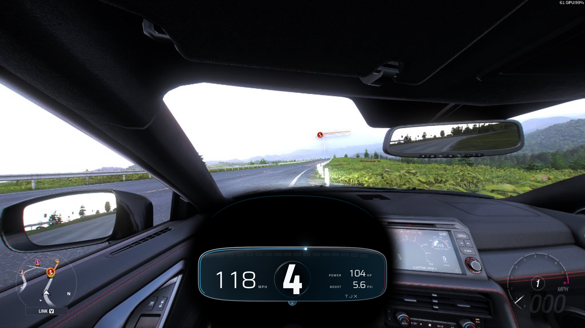
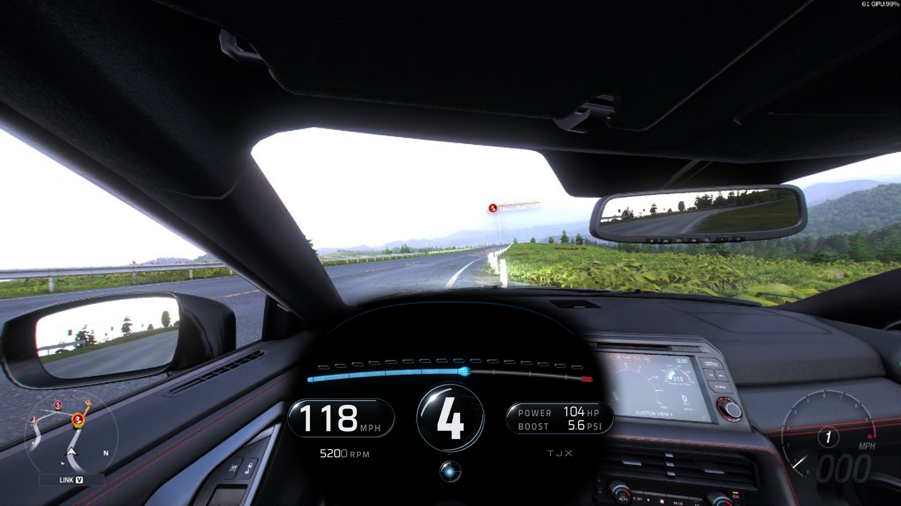

# HANDOVER: Dash · Liquid Glass (catalog row 1)

**Thread / branch:** thread 1 of the v2 rebuild plan, committed on `main` in the shared checkout (the coordinator's merge rule, AGENTS.md rule 16)  **Date:** 2026-11-27  **Result:** ✅ complete. Closed by self-review: TJX asked to be hands-off (AGENTS.md rule 12).

This replaces the handover of the first pilot, which TJX rejected on 2026-11-27 (that file is in the git history). Findings and yes/no answers only; there are no scores in this file.

## Exit criteria (`CLUSTER_PROMPT.md`)
| Criterion | Met? | Evidence |
|---|---|---|
| The introduction was posted, and the thread is not archived | yes | the thread's first message; the thread is open |
| `RESEARCH.md` is written, with sources | yes | [RESEARCH.md](RESEARCH.md): 16 Apple behaviours with sources, the CarPlay Ultra facts, the benchmark table in §3.1 |
| The design board is the Penpot page `07 · LiquidGlass`, 4 states per view, its IDs in the catalog row and here | yes | page and board IDs under "What sibling dashes must know"; CATALOG.md row 1 |
| A bespoke ComfyUI asset and a bespoke Blender asset are used, with ledger rows and 4K masters on Drive; the before and after pair is here | yes | [assets/clusters/liquid_glass/ASSETS.md](../../../../../assets/clusters/liquid_glass/ASSETS.md); "Assets and masters"; "Before and after pair" |
| The module is complete, with no TODOs, and goldens pass | yes | "Verification output" |
| 4K renders, the 60-frame sequence and the product page are in `mockups/LiquidGlass/` | yes | `mockups/LiquidGlass/` (gitignored), written by the final `preview-export` run |
| The live bench report and the GPU time under 0.5 ms are recorded | yes | "Verification output" and "Live bench" |
| The direction check was posted and self-reviewed to a go, with its findings here | yes | "Direction check (self-review)" |
| Every line of the closing review is yes, or a line that could not be fixed afterwards is reported | yes | "Closing review": lines 21, 30 and 34 are a no about past work. Line 39: visual-review lines V5 and V13 are a no from the one cold read, which cannot be repeated at this review point; V6 and V12 are rule questions; V15 is a deliberate layout change. Each is reported in the thread and to the coordinator |
| The handover is written, the job is reported for the merge, and the product page and checklist are posted | yes | this file; the thread's closing message |

## What was built
- **Optics spec:** [docs/specs/optics.md](../../../../../docs/specs/optics.md) replaces card P8-1: the surface profile, exact Fresnel, Snell refraction through a piece, dispersion at the sRGB primaries, Beer-Lambert absorption, the GGX key light, the studio, the pixel footprint filter, surface waves, display-light compositing and the corrected sci-fi equations, with one test per equation (§13) and sources S1 to S28.
- **Kit (`crates/fh6-kit`):** `optics.rs` (the CPU reference), `OpticalGlass`, `Environment` and `Ripple` (`paint.rs`), `Shape::Blob` with `Piece` and the smooth union (`shape.rs`), the glass path in `shaders/shape.wgsl`, `tokens.glass.optics`, HDR KTX2 loading, an anisotropic sampler for environment maps, tight bounds for arcs, a faster PNG loader, and a file cache in `Images::load_file`. GPU tests in `tests/glass_gpu.rs` and `tests/render_gpu.rs`.
- **Shared components:** `GearGlyph::snap` and `HeroGear::snap` (a cluster built mid-race shows its gear at rest), and `entry()` on both (the glyph's entry motion, which the upshift ripple waits for).
- **Dash:** `mod.rs`, `spec.md`, `README.md`, `RESEARCH.md`, this file, and the 8 goldens.
- **Assets:** `tools/asset-forge/src/recipes/liquid_glass.rs` and `assets/clusters/liquid_glass/`.
- **`preview-export`:** each shot's GPU time is the median of 5 frames, and `index.html` is the dash's product page.
- **Rule files:** the hands-off self-review in AGENTS.md rules 12 and 13, CLUSTER_PROMPT.md and the other places listed under "Shared places touched".

## Telemetry
Every field the dash reads is covered by the golden packets or derived from them, through `fh6_kit::Signals`:
- **Read as they are:** rpm (current, idle, limiter), gear, speed, the race flag, power (W) and boost (psi).
- **Derived:** lateral and longitudinal G from acceleration x and z; body slip from velocity x and z; the rpm rate from rpm; the shift point from the limiter rpm and the tokens (or the car profile's `ShiftPointPct`).
- **Not read:** tyre slip, temperatures, fuel, suspension and every other offset that the golden packets do not cover.

## Verification output
The last run (20:41Z to 20:46Z): HEAD 9afae78 plus this thread's changes, built in an exact copy with its own target folder, under the local `gpu.lock`. The files to commit are byte for byte the ones this run built (checked with `cmp`). `main` has since moved to 0910c3b, which changes only `tools/visual-review`, `.claude/` and rule texts, none of which this build uses.

`cargo run --release -p preview-export -- --cluster LiquidGlass` (GPU time is the median of 5 frames per shot):
```
  01_idle                   0.346 ms GPU   16 draws    59 instances
  02_mid_cruise             0.357 ms GPU   18 draws    67 instances
  03_redline_strobe         0.425 ms GPU   18 draws    87 instances
  04_drift_braking          0.464 ms GPU   18 draws    71 instances
  hood_01_idle              0.317 ms GPU   16 draws    59 instances
  hood_02_mid_cruise        0.324 ms GPU   18 draws    67 instances
  hood_03_redline_strobe    0.413 ms GPU   18 draws    87 instances
  hood_04_drift_braking     0.443 ms GPU   18 draws    71 instances
  sequence: 60 frames, GPU p50 0.365 ms, p99 0.428 ms
```
Goldens and tests:
```
cargo test -p fh6-clusters --lib liquid_glass      (before the render)
  test result: ok. 12 passed; 0 failed; 0 ignored; 0 measured; 188 filtered out
cargo clippy -p fh6-clusters --all-targets -- -D warnings
  Finished `dev` profile [unoptimized + debuginfo] target(s)   (no warnings)
FH6_UPDATE_GOLDEN=1 cargo test -p fh6-clusters --test golden_images liquid_glass
  test result: ok. 1 passed; 0 failed; 0 ignored; 0 measured; 48 filtered out
cargo test -p fh6-clusters liquid_glass            (run 1 and run 2, the same each time)
  test result: ok. 12 passed; 0 failed; 0 ignored; 0 measured; 188 filtered out
  test result: ok. 1 passed; 0 failed; 0 ignored; 0 measured; 48 filtered out
  goldens unchanged by the two runs (sha256 of all 8 before and after)
```
Unchanged since earlier runs, so not run again: `cargo test -p fh6-kit --test render_gpu` (18:47Z: 6 passed; the closing fixes touch no kit code); and for the recipe (19:12Z) `cargo test -p asset-forge liquid_glass` 7 passed, `cargo check -p fh6-clusters -p asset-forge` and `cargo clippy -p fh6-clusters -p asset-forge --all-targets -- -D warnings` finished with no warning. `rustfmt --edition 2021 --check crates/fh6-clusters/src/clusters/liquid_glass/*.rs tools/asset-forge/src/recipes/liquid_glass.rs` prints nothing.

## Live bench
`FH6_WheelDash --demo --cluster <theme> --stats --bench-seconds 60` with `mock-udp --scenario bmw_m4_cs --rate-hz 60`, back to back, on the laptop's 300 Hz panel (the reports are in `mockups/LiquidGlass/live_bench*.md`). The scaffold is VisionSpatialGlass (catalog row 8, still ☐). No error or panic in the log.

| Series (ms) | LiquidGlass p50 / p99 / max | Scaffold p50 / p99 / max |
|---|---|---|
| Frames presented | 8060 (134.3 fps) | 8245 (137.4 fps) |
| New packets shown | 3187 | 3515 |
| Packet receive → `present` returned | 0.870 / 2.334 / 3.019 | 0.835 / 2.336 / 8.024 |
| CPU per frame | 0.811 / 1.620 / 3.923 | 0.769 / 1.523 / 9.832 |
| of which upload + record + submit | 0.570 / 1.194 / 3.515 | 0.528 / 1.092 / 1.407 |
| Packet receive → next vblank (estimated on screen) | 2.631 / 4.896 / 5.787 | 2.583 / 4.794 / 10.141 |

- **The dash's own CPU share is under 0.3 ms.** The difference of the two p50s is +0.04 ms. Across the back-to-back pairs of this afternoon it was +0.01 (17:45Z), +0.11 (18:48Z), −0.11 (19:21Z; printed in this thread's session, the report file was overwritten by the next run), −0.35 (19:44Z) and +0.04 ms (20:45Z): smaller than the bench resolves. Because of known defect 17 that number leaves out `draw()`, so the dash's own work is also measured offscreen: `bench-render --frames 600` gives `update` + `draw` ("record") 0.015 ms p50 and 0.033 ms p99 at 3840 × 2160.
- **GPU (`bench-render`, the same run):** 0.346 ms p50 and 0.380 ms p99 (max 0.388) with bloom, 0.219 / 0.242 without, and 0.429 / 0.451 with the OEM scrim at 100% and the ambient wash on top. With bloom that is 0.06 ms above the 19:22Z run (0.283 ms, 13 draws): the foot row after the glass and the screened bead take the frame from 13 to 16 draws, while the unchanged Porsche Analog scaffold measured the same in both runs (0.094 and 0.095 ms). A 19:45Z run that overlapped another thread's builds slowed every scenario's GPU time alike and some record times far more (Liquid Glass record p99 0.362 ms), so it is not used.
- **Met in this run:** receive-to-present p99 2.334 ms, under one 3.33 ms refresh, for the dash and the scaffold alike. **Not met, and not the dash's:** the app's CPU p99 is over 1 ms in both: known defect 10, reported to the coordinator.

## Direction check (self-review)
- **First render**, posted in the thread at 14:58Z with the full-frame cockpit render of `02_mid_cruise`, its close-up and the Penpot board export: flat-faced glass pieces with thin rims.
- **TJX, 15:18Z, in the project chat:** "exactly we want 2027 future not anything less just modern in all fairness". Decision: **go with changes**. The direction (separate floating glass that reads by how it bends light) is right; the render was only modern.
- **Changes made for it.** Second build (7be8b37): every piece is a dome and so a lens, the gear is magnified about 1.15 times, an upshift sends a ripple across the gear lens, the capsules are shallow domes, the rev rod is graduated, hard braking fuses the pieces, and the studio light leans to the car's colour. Third build (0f53915): the review fixes listed under "Review findings".
- **Second render**, posted at 15:37Z. The coordinator asked TJX for a go at 15:59Z. **TJX, 16:00Z:** "yeah i mean as soon as you can and working with other chata go through it, you should have installed skills to be revieweing this yourself more so i can be hands off". The coordinator answered that the pilot had its go and would finish. **TJX, 16:01Z:** "good there is no rush, when fable runs out switch to opus max and ultracode if you wanna smash it out". Decision: **go**, and from then on the self-review stands in for TJX's check.
- **Later, through the coordinator (18:27Z):** TJX: "i want fucking god tier on hoiw muh ive sprnt". The coordinator's brief: use the GPU for full-quality 4K renders, and close only when the pilot would pass for a real 2027 production cluster.
- **One departure from what TJX was told.** At 15:22Z the coordinator told TJX the pilot would add "colour pools under each piece of glass that the edges visibly bend and split". Both were dropped: a pool of light under the glass turned the faces navy, which rule 7 of the design rules forbids, and sapphire this thin splits colour by under a pixel (optics.md §5), so splitting would have to be faked. The studio light's lean to the car's colour carries the colour instead. TJX has not commented on it.

## Review findings
Each source was run once at its review point; findings, not scores.

**Hands-off review (16:07Z to 16:24Z, on the second build):** `design:design-critique`, `design:accessibility-review` and `rust-review`. Fixed in the third build (0f53915):
- The rank order was not held by brightness → the gear lens is clear glass, so the numeral stays white; the rev ribbon burns at half strength with a full-strength head.
- Shift lights and labels too small → 56 × 22 cabochons at a 72 px pitch; labels and units at 24 px.
- The upshift ripple bent the numeral → it runs through the rim only; the numeral moves at most 1.5 px (unit test).
- Square halo edges on black (`p.glow` stops at 3 sigma) → radial gradients that end at zero.
- The G lens too small, and crowded on the hood → larger, over a crosshair and a 0.5 g ring; beside the gear on the hood.
- Reduced flash still showed transient light → it also leaves out the ripple, the swell and the lap of light.
- Thin plate lights read as scratches in the rims → the studio plate is softened in linear light before Blender bakes it.
- A failed asset load was silent → it is logged.

**The visual-review tool (`tools/visual-review`, run by its own thread on the third build's renders):**
- The rpm and power digits flickered every frame on the limiter → `Readouts`: the raw values, each held until it moves by 100 rpm, 1% of the power (at least 3 hp) or 0.3 psi, as the speed is held by 0.6 (unit test `the_readouts_hold_still_on_the_limiter`). A first version also smoothed power and boost; the flash audit then still marked their digits on the limiter, because a smoothed value is still settling when the car reaches it, so the smoothing was removed.
- The labels were brighter than the tokens' 20% cap for parts that never change → labels, units and the logo at 19% relative luminance, still 4.8:1 on black (unit test `the_parts_that_never_change_stay_under_the_static_cap`). Measuring again found two more static parts at full data brightness: the boost's decimal point, and the rpm readout's last digit, which is always 0 because the readout is to the nearest 10. Both are now drawn in the static ink too.
- The colour-blind check passed: the redline loses its red, but its position still carries the meaning.

**Closing review, first walk (this file's checklist, walked by four section reviewers, each "no" checked by a second agent):**
- The power and boost capsule out-read the G lens → power, boost and the rpm readout are secondary data at rank 4 with the G lens, at 86% of the ink (the muted ink, tried first, fell under 4.5:1 in the glance test at this size); the G light is a larger point with a soft halo.
- Zero-length arcs could leave a stray tab when the shift point is at 0% or 100% → only arcs at least 1 px long are drawn; the rpm readout's cap has the 22 px floor; the frame time is clamped.
- The Blender masters were 2048 px faces → re-rendered at 4096 px a face, plus a 16-bit master of the environment map itself.
- The app builds the cluster again on every change of view or theme (`ensure_cluster`), and each build decoded and uploaded both 4096² textures again: a stall on the render thread and about 170 MB more video memory each time → the kit's `Images::load_file` now hands back the texture it already has for a file that has not changed (GPU test `a_file_loads_once_until_it_changes`).
- The CarPlay Ultra benchmark had features neither matched nor listed → three rows added to RESEARCH.md §3.1.
- optics.md lacked sources for the surface profile, the smooth union and the ripple, gave the light law in another convention, and called the caustic tracer broadband → sources S23 to S28, the code's light law and tilt, and the monochrome tracer described.
- The handover's numbers, telemetry statement and TJX's answers were missing or out of date → this file.
- The order of work after the first boards (line 30) cannot be fixed afterwards; see the closing review.

**Critic pass (four defects, each diagnosed by one agent and checked by a second, read-only):**
- **Show.** The numerals, labels and black cores faded in by opacity, and the side capsules grew out of the gear lens as buds, so for the first frames the labels piled on top of each other; a cluster built mid-race in gear also played a gear change and an upshift that never happened → only the glass grows in (its thickness, never its opacity), everything else is at full strength and at rest from the first frame, and the first update shows the gear and the ribbon where they are (`HeroGear::snap`, `GearGlyph::snap`; unit test `snap_shows_the_gear_at_rest_with_no_change`).
- **Ripple.** The ripple started on the frame the new gear began its entry slide, so its wave crossed the incoming glyph → it waits about 100 ms (`RIPPLE_DELAY`, 0.24 of the flex) for the entry to settle, starts at 0.9 of the radius, and is left out for a two-character gear or a glyph coming in from above (a downshift). The unit test traces every sight line in both token sets and finds no glyph moved by more than half a pixel, while the rim wobbles past 3° for at least 0.12 s and peaks above 5°.
- **Studio.** A kicker card mirrored across the numerals' clear zone, and the clear cone round the viewer (22°) was half what a 22° surface tilt needs (a mirror doubles the angle) → the kicker is gone, the cone is 44° (fading out by 45°), and the environment stays level while only the key light leans, so the cone stays on the viewer at any G. Rebuilt at 4096 px faces and 256 samples on the cloud lane (recipe test `every_light_is_a_long_strip_outside_the_clear_cone`). The second agent also proposed fading the ComfyUI plate between 22° and 28°; not done, see "My calls".
- **GPU tail.** Single frames near 2.8 ms in some bench runs. Both agents found nothing in the dash or the kit that makes identical frames slower; the evidence points below wgpu (the laptop GPU's clocks or the Windows GPU scheduler). No code change; a request for bench-render instrumentation is under "Requests for shared code".

**Closing visual review, first pass (this file's "Visual review", on the frozen 18:44Z renders):**
- **The labels outside the glass were drawn at 3% luminance instead of 19% wherever nothing opaque lies under them** (the hood view, where the scrim is off, and the cockpit with the scrim turned down), and the rpm digits and the idle bead well under their design level. The overlay's resolve hands DWM the colour up to its alpha as coverage, and DWM blends encoded values; `static_ink` dimmed the alpha, which is right only over something opaque in the same frame (the cores under the capsules and the cockpit scrim, where they did show as designed). `probe` of the plain render measured the RPM label, its fixed 0 and the name badge at 0.033; the bead at idle at 0.07 against 0.19 designed → `static_ink`, the secondary data ink and the bead's light scale the light and keep the coverage (`Color::intensity`). The unit tests now check what the overlay shows, through a port of the resolve law (`shown_on_black`); the old code fails them.
- **The shift strobe could start on its dark phase.** `ShiftLights` strobed on the app's clock, so in the review sequence the strip went from fourteen lights to none at the shift point (frame 27) and stayed dark for 50 ms → the strip strobes on its own clock from the shift point (`Strip`, which `update` runs), so the first 50 ms are lit (unit test `the_strobe_starts_on_at_the_shift_point` at 60, 120, 144 and 300 Hz, after a 50 ms frame, and still whole after 20 s on the limiter). The same fault is in every dash that passes the app's clock; see "Requests for shared code".
- **One zone of the first glance pass was mis-drawn by me** (the hood rpm box cut off the digits' tops, so it read 3.6:1 to 5.0:1); the second pass uses a corrected box.
- **Second pass: the rpm readout measured 4.4:1 in the hood drift state** ("7100": the thin 1 and 7, in the open, where no lens magnifies them), under the 4.5:1 its data needs → a 34 px floor for that readout (`RPM_CAP`, the tokens give 30), re-rendered and measured again.
- **Found on the way, and a lesson for the review tool:** the cockpit composite draws the cabin photo and the scrim in the same frame as the cluster, so anything with partial coverage blends linearly there and looks right; the alpha-dimmed labels passed in the composite and showed at 3% only in the plain render. A coverage fault shows on the plain render (the hood view, or any scrim below 100%), so glance and probe both.

**Pre-commit check (three fresh agents, read-only: the late code, the handover's facts, the commit's hygiene):**
- **The bead's light covered the ribbon's head.** Scaled by light, its gradient became opaque, so its dimmer shoulder hid the ribbon under it: a dark collar behind the bead in `02` (about 38% of the light), and a grey head instead of a red one on the limiter → the bead's light is screened onto what lies under it (`BlendMode::Screen`): it never darkens the ribbon, shows at its level over black, and runs up to white on the limiter.
- **The bead jittered on the limiter.** The ribbon followed the engine's bounce (8690 and 8640 rpm on alternate frames), so the bead moved 1 to 3 px every frame: 623 px flashing at 30 Hz in the flash audit, next to the strip → the ribbon follows the rpm through a 60 rpm backlash (`REV_BAND`, `backlash`) and gets no feed-forward while it holds, so the bounce leaves it still and a pull is drawn at most 30 rpm (under 5 px) behind (unit test `the_ribbon_holds_still_through_the_limiter_bounce`).
- **The strobe test did not drive the code `update` runs,** so a return to the app's clock would have passed it; the clock also counted the frame time before the shift point and was never wrapped → the strip and its clock are one type (`Strip`) that `update` calls and the tests drive; the clock starts at 0 on the shift-point frame, adds each later frame's own time and wraps at 1 s.
- **Reduced flash dimmed the strip by coverage** (its 2 Hz breath fell to about 11% on black) → in reduced flash the breath scales the light (35% to 100%).
- **Tests that could not fail** (an identity check of the bead colour, a cap check true for any input, the secondary data compared with the speed outside its glass) → replaced by the strip and backlash tests, a constant check of the caps, and the speed seen through its capsule.
- **Doc comments** (the rpm cap's source, "one baseline" on the foot row, ISO 15008 at 16.5 px here) and **this file** (the blind read's rpm zones, V13, the bloom outside the envelope, evidence paths and dates, several numbers) → corrected; the decision-log row moves to the end of `docs/PROGRESS.md`, and the catalog row and the family spec quote the final figures and the 44° cone.

## Visual review (`fh6-visual-review`)
Walked on the final renders after one fix round. The first pass, on the frozen renders of 18:44Z, found the coverage and strobe defects under "Review findings"; both were fixed, the set was re-rendered (19:17Z), the whole list was walked again, and one more no turned up (the rpm readout at 4.4:1 in one hood state); with it the cold reviewer's two fixable findings (a smear in the speed capsule's rim, a strobe still that read as off) were fixed, and the set was rendered again (19:40Z). The pre-commit check then found four faults in the late code (the bead covering the ribbon's head, the bead jittering on the limiter, a strobe test that did not drive `update`, and the reduced-flash breath; see "Review findings"). After those fixes the set was rendered a last time (20:41Z), and every measured line was run again on it; the answers below are from that run. The evidence files are under `mockups/LiquidGlass/review/` (gitignored); the kept shots are in `docs/handover-shots/`.

**Frozen expectations** (written at 17:35Z, before any final render existed):
- Rank order: 1 the gear and the 16 cabochons with the strobe; 2 the speed; 3 the rev ribbon with its bead; 4 the G lens, power and boost, the rpm readout; 5 labels, units, the logo, rims.
- Benchmark inventory (RESEARCH.md §3.1) with tolerances: F1 revs as one thin bar in one accent (lane at most 22 px, one hue below the redline); F2 one large value alone in the centre lens; F3 every colour from a palette role; F4 true black outside the pieces; F5 at least 7 kinds of separate pieces, cabochons fused by frames 38 to 41, capsules fused with the gear lens in `04_drift_braking`; F6 rim highlights move between `02` and `04`; F7 no grey haze inside a piece; F8 speed as digits, a deliberate change.
- Key frames: limiter at frame 29 or 30, strobe 30 to 41 at 3 on and 3 off, upshift at 42, pull 45 to 59, no digit change through 30 to 41.
- The tool's default blur levels; static parts at or under 0.20; TJX's five rejection patterns; and the NOT ASSESSED list below.
- Two expectations met facts afterwards, logged without changing them: the strip strobes from the shift point, which this sequence reaches at frame 27, not at the limiter; and the drift state brakes at 0.58 g, under the 0.75 g at which the capsules fuse, so F5's "fused in 04" cannot show there (the pieces reach for each other; the fusion at full braking is held by the unit test `the_pieces_float_apart`). On the 19:17Z renders the cabochons first showed fused at frame 39, because the dark phase hid the necks; since the dark phase keeps a glow, the necks show from 38, as expected.

**Cold look** (written before opening the notes, from the cockpit composite of `02`, its mirror and its luminance view): "The cluster sits low in the frame in a dark dome over the cabin photo. My eye goes to the large white 4 in a round glass lens in the middle, then 118 MPH in a horizontal capsule on the left, then the blue bar above, then the right capsule with POWER 104 HP and BOOST 5.6 PSI, then 5200 RPM under the left capsule, the name TJX under the right one, and a small round lens with a blue-white dot under the gear. White numerals; a light-blue bar from the left end to just past the middle with a bright bead at its head, grey to the right and a short red end; sixteen dark pill outlines above it; grey labels. The gear lens shows a bright crescent upper left and a thin rim; the capsules show thin bright rims and a highlight upper left; the bar looks like a lit rod. The labels look flat and printed. In the luminance view the numerals are brightest, the bar mid, the labels mid-grey."

**Premortem.** The likeliest rejection: "it still reads as capsules with text, today's widgets rather than a 2027 instrument". Against TJX's recorded rejections, each on a named crop: (a) it is not CarPlay Ultra's layout, by design (V15); (b) no faint texture stands in for a material: the pieces read by rims and lensing in the full frame, and their bodies are black (`materials_close.png`); (c) no slab: seven kinds of separate pieces with true black between them (`probe` of the gaps: 100% off); (d) the pieces are working lenses: the gear is magnified about 1.15 times, and the rod's graduations bend through the bead; in that render the speed capsule's rim also bent the rpm digits below it into a smear (`frozen1/review/z_under_speed.png`), which the cold reviewer flagged and the final build removes; (e) no murky glass: the bodies hold 1 to 8 of 255.

| Line | Answer | Evidence |
|---|---|---|
| V1 | yes | the expectations above, frozen at 17:35Z; the final renders date from 18:44Z, 19:17Z, 19:40Z and 20:41Z |
| V2 | yes | the cold look and premortem above; `02_mid_cruise_cockpit_crop_1160_1475_1520x640_mirrored.png`, `02_mid_cruise_cockpit_luminance.png` |
| V3 | yes | one fresh-context `ui-ux-designer` agent got the packet once (seed 23: `A.png` and `glance_01` to `glance_08`, neutral names, the logo zone masked; no reference photo, as none is kept locally). Each finding is recorded under "Cold reviewer" below as fixed or not fixed |
| V4 | yes | "Noticed first: the '4'. Second: '118'. Third: the blue rev rod and its bead." |
| V5 | no | against the key (`blind_key_23.txt`, for the 19:17Z renders the reader saw): the gear right on all eight frames and the speed within 1 on all eight. The shift lights were read as each still shows them on all eight (full on 01 and 02, filling on 03, 04 and 07, off on 05, 06 and 08); a still cannot show a strobe, and 01, 02 and 06 are one limiter hold in its lit and dark phases. The rpm zone was one band high on two frames, against the tool's bands (under 50% low, under 80% mid, under 97% high): `glance_04` (74%, read high) and `glance_05` (46%, read mid). The read cannot be repeated at this review point. Since then the dark phase keeps a fifth of the shift colour (`Strip::light`, unit test `the_strobe_dark_phase_keeps_a_glow`), so a still of the limiter no longer looks like idle |
| V6 | no, for the static labels only | the blur gate (960 × 540, sigma 1.5) on the cockpit composites and the 4K hood renders: gear 12.3 to 18.0:1 and speed 11.7 to 14.1:1 in all four states of both views; for graphics (3:1) the lit shift strip 6.6 to 9.1:1, the ribbon head 3.6 to 15.0:1 and the G light 3.3 to 5.7:1; for data (4.5:1) power and boost 4.6 to 5.4:1 and the rpm readout 4.7 to 6.6:1, also on the plain renders with no scrim under it (4.7 to 6.1:1). The no: the static labels and units measure 2.2 to 2.5:1, the RPM label 2.3:1 and the name badge 1.6:1 (unblurred they are 4.8:1). At the tokens' 20% cap for static parts, a label stroke 24 px tall keeps only about 35 to 40% of its peak through that blur; the two rules conflict for labels, reported as a rule question (`glance/`, `glance_plain/`) |
| V7 | yes | `squint_stages.png` (sequence frames 05, 23, 26, 27, 30): idle (no lights, empty rod), filling (green, then amber and red, outside-in), strobe on (all 16 in the shift colour) and strobe off (the 16 at a fifth of that light, the full rod and the white bead) are each plainly different |
| V8 | yes | `Geom` and the tokens, confirmed on 1:1 crops: gear cap 156 (cockpit) and 136 (hood), seen about 1.15 times larger; shift cabochons 56 × 22 and 58 × 20; speed cap 100 and 88; power and boost 36 and 32; rpm 34; labels and units 24; every stroke and arc at least 1 px (`MIN_ARC_PX`) |
| V9 | yes | the limiter-hold flash map marks no digit (`flash/flash_map_30-41.png`); `rpm_hold.png` and `info_hold.png` show the same digits on every frame 29 to 41 |
| V10 | yes | each state's `<state>_cockpit_glance.png` against its `_squint.png`: the labels, units and rims go first, then the G light and the secondary data, the ribbon and the speed; the gear and the lit strip last |
| V11 | yes | `static` over the four states and frames 10 to 59 (`static_cockpit.png`): static p95 0.190 (cap 0.2), live p95 0.885. The large static areas are the labels, units, the RPM label, its fixed 0 and the name badge, at 0.187 to 0.190, and the G lens's scale at 0.193. Smaller areas over the cap, each named: strokes the live digits happen to share in every picture (the speed's last digit, 199 px; the power and boost digits, which the sequence holds at 16.0 psi; the rpm cells: up to 0.84, live data, not static parts), and small rim highlights where the glass mirrors the level studio (1 to 172 px each, p95 0.20 to 0.52, at the capsules' ends and the G lens): the environment stays level by design so the clear cone stays on the viewer, and only the key light swings. The hood run says no (static p95 0.836) because it has the four states only, so live digits that share strokes look static; its other areas are the same kinds |
| V12 | no, for the colour budget only | red appears only in the red zone of the rod, the bead's warning halo on the limiter and the reverse gear; in every `cvd` view (`cvd_03`, `cvd_04`) the stages still read by count and position (lights fill outside-in, the bead's place). The product page's measured shares: base hue 4 to 14% of lit pixels (budget at least 80%), white 10 to 18% (budget at most 15%, over in both idle states), red 0 to 1% (budget 5%). The budget assumes one accent colour carries the dash; clear glass with white numerals is mostly neutral by design (RESEARCH A10). Reported as a rule question |
| V13 | no | "Don't know. It doesn't match any production car I can name. The glass capsules and lenses look like Apple's Liquid Glass style (iOS 26 / CarPlay Ultra), but I'm not sure, and as noted above that read isn't blind." The reader said the project instructions in its context describe a Liquid Glass style, so its guess was prompted. A no from the one read, which cannot be repeated at this review point |
| V14 | yes | F1 lane 16 px wide (rod half width 11 minus 3), one hue (`primary`) below the redline and `warning` past it; F2 nothing else is drawn under the gear lens, which shows only the studio's reflections and its neighbours' edge images; F3 no literal colour in `draw()`; F4 corners and gaps 100% off; F5 seven kinds of pieces, cabochons fused by frames 38 to 41 (`strobe_fused.png`; the dark phase's glow shows the necks forming in 38), the capsules reaching in `04` (0.58 g) and fused at full braking (unit test); F6 the highlights move between `02` and `04` (`light_swing.png`); F7 bodies at 1 to 8 of 255, median luminance 0.0018; F8 digits, as planned |
| V15 | no, a deliberate change | Apple's CarPlay Ultra press images (viewed in the browser on Apple Newsroom, 2025-05-15 release) show two ring gauges with the gear inside the tachometer and a centre widget; this dash puts the gear alone in a centre lens between two capsules, with the revs as a bar across the top. Blurred to masses, the two arrangements differ in both left/right orders. RESEARCH.md §3.1 lists the change, and TJX approved this direction at the direction check ("exactly we want 2027 future") |
| V16 | yes | `board_vs_render_cockpit.png` and `board_vs_render_hood.png` (the Penpot boards exported at 3840 × 2160 at 19:12Z, against the 20:41Z renders): every zone in the same place at the same size (the board's "CAR LOGO" is the render's custom name); the render is plainly richer than the board and the before render (lensing, rims, the lit rod) |
| V17 | yes | in the full frame and the composite every piece reads as clear glass: one key-light crescent upper left on every dome, a cooler arc opposite, rims whose width follows each piece's size |
| V18 | yes | the materials checks that apply, below |
| V19 | yes | the gear is magnified about 1.15 times and the rod's graduations bend through the bead; bodies clear over black (1 to 8 of 255, no tint or frost); rim lines crisp and wider on the bigger domes (`materials_close.png`); highlights move between `02` and `04` (`light_swing.png`); no glass sits on glass (one glass layer, pieces only fused); fused necks smooth (`strobe_fused.png`, `neck_04.png`) |
| V20 | yes, with the glow outside the envelope named | `stretch` of all eight states: every non-off pixel is a piece, its rim, its light or that light's bloom; no rectangle edge, haze or speckle; the frame's corners are off; dark gradients (the halo, the bead's glow) are smooth. Outside the view's envelope plus 40 px: none in `01` and `hood_01`, 32 faint pixels in `02` and 4,475 in `hood_02`; the lit cabochons' bloom in `03` (64,972 px, 11,731 of them above 8 of 255), `04` (18,343 faint), `hood_03` (92,009, 27,108 lit) and `hood_04` (36,508, 203 lit). That bloom reaches above the envelope by design; the coordinator was told and agreed it is intended glow (thread relay, before the close) |
| V21 | yes | discrete signals change on the data's frame (stages, strobe from 27, gear at 42, digits); the ribbon's head sits against the 1000 rpm marks where the data puts it frame by frame (`ribbon_track.png`, 21 to 28), with no overshoot; `motion`: no stall in either pull |
| V22 | yes | `flash --frames 30-41` on the 20:41Z sequence: flash audit yes. Of the 18,474 px that flash faster than 3 Hz, 18,451 are the 16 cabochons (16,685 at exactly 3 on and 3 off, 10 Hz; the rest at their edges and fusing necks, with uneven phases), and 23 px are at the bead's edge, where the strip's bloom reaches its halo; no red flash; the worst 10° field holds 5,584 of 21,526 px² (3,931 of 10,982 at scale 1.4 and 0.6 m); nothing flashing is taller than 23 px (the limit is the strip's 42 px). The 19:40Z sequence also had the bead jittering with the engine's bounce (623 px at 30 Hz): fixed by the ribbon's backlash (`bead_strobe.png` now shows a still bead) |
| V23 | yes | `upshift_1to1.png`: 3 on frame 41, 4 on frame 42 (the frame the data changes), entering from 24 px below at 1.12 times and settled by frame 45; no blank or doubled frame |
| V24 | yes | `motion`: the spikes are the shift point (27: the strip turns to the shift colour), the strobe edges (30, 33, 36, 39) and the gear change (42 to 44); the idle frames 1 to 9 move because the glass grows in on show, as designed |
| V25 | yes | see "Before and after pair" |
| V26 | yes | all 8 final goldens opened (`goldens_cockpit.png`, `goldens_hood.png`) and diffed against HEAD's (`golden_diff_*`: 4.2 to 6.7% of pixels changed, the changed area always the cluster, the largest change at the rpm foot row); every difference is a change made in this round (the studio without its kicker, the show, the labels and the rpm digits by light, the rpm size, the foot row over the glass, the strobe's clock and dark-phase glow, the screened bead) |

**Cold reviewer** (V3; positions are the reader's, as shares of `A.png` or a glance frame). Fixed:
- A strip of "garbled light marks" under the speed capsule, as wide as the rpm readout: the capsule's lower rim bent the rpm digits below it into a smear. The foot row now draws after the glass (`draw_foot`); `probe` of a 420 × 20 px strip under the speed capsule finds no lit pixel in either view (`ghost_check_02.png`).
- `glance_06`, a still of the strobe's dark phase, read as "off" at the limiter: the dark phase now keeps a fifth of the shift colour (`Strip::light`; frame 31 of the final sequence, a dark phase, against frame 28, lit, in `strobe_strip.png`).

Not fixed, each with the reason:
- "Scratch-like streaks" at the right ends of both capsules and inside the gear lens's right side: reflections of the ComfyUI studio plate, under 1% luminance (`probe`), the lines the critic pass also found. Removing them means fading the plate where the inner rims look; listed under "Known issues / debt".
- The dim last digit of the rpm readout reads as a dead digit, or as "520": to the nearest 10 that digit never changes, so it is drawn at the static cap as the coordinator asked. A rule question for TJX: show it at the data level, or drop it.
- The rpm readout looks cut off, with an empty area under the power capsule: that area holds the name badge, which the packet masks.
- The bead reads as a slider knob; the rod has no numbers and the redline is a short red cap; the rod's fill looks flat: the meniscus bead and one thin unnumbered bar are the design (CarPlay Ultra's bar grammar; the rpm readout gives the number), and the caustic is a 12% shimmer that shows in motion.
- The glass reads as glossy black plastic, with no visible magnification: clear glass over black shows only its edges (optics.md §7), and the gear's 1.15 times has nothing to be compared with; over the game it bends the scene, which the review set cannot show.
- The unlit cabochons look like a row of keys; the small G lens reads as a button: both are the design (clear glass with a rim; the G lens's 0.5 g ring and crosshair stay faint as static parts).
- The key light's crescent beside the gear reads like a bracket: it peaks at 0.68 against the numeral's 0.80 (`probe`), as `KEY_SHARE` intends; a softer crescent is a possible refinement.
- Small notches at the gear lens's left and right rims: the capsules' content seen through the lens's steep edge, a few pixels.
- The cluster looks pasted onto a black patch: the OEM scrim (Phase 8) in the composite, not this dash.
- The limiter colour is violet, close to the rod's blue, and never turns red: the palette's shift role, which the driver can theme; red stays for the redline and alarms.
- The cabochons fill outside-in while the rod fills left to right: the shared `ShiftLights` convention and the tokens; an HMI question worth a family decision.
- The 3 in `glance_08` is taller: that frame is the gear change itself (the entry from 1.12 times, settled within six frames).
- The smallest text is faint: the static cap against the glance gate (V6).
- Speed per 1000 rpm and a constant boost look odd: the review telemetry, not the drawing.

**Materials checks that apply** (`references/materials.md`; dropped: G22 and G23 (no coating, no prism), E4 (no crystal over a dial), L4 and S1 to S4 (no needle, no stacked parts, no sprites), M1 to M8, C1 to C3 and T1 to T3 (no metal, carbon or trim), W3 (no reference photo kept locally)):
- **yes:** G1 (bodies black, light lines only), G2 (brightest on the key side with a cooler arc and a second inner line; `materials_close.png`), G3 (thin rims on pills, wider on the gear dome), G4 (the ribbon is as sharp through the rod as outside it), G5 (no picture inside a piece; the faint studio lines in the gear lens's inner rim band are reflections, under 1% luminance), G7 (the gear is shown about 1.15 times larger), G8 (a lit cabochon fills to its outline; the bloom is a separate halo), G9 (the middles mirror nothing), G11 (colourless over black), G12 and G13 (no colour fringes at 1:1; sapphire this thin splits by under a pixel), G14 (no violet sheen on the rims), G15, G16, G17, G18, G19 (no highlight crosses a numeral's strokes), G20 (true half-circle capsule ends), G21 (the caustic lives only in the rod's light and flows with the engine), L1 (the highlights move together between `02` and `04`), L2 (one key upper left, one cool rim opposite), L3 (one highlight each in `04`), L5 (edges reflect more than faces), E1 (an unlit cabochon reads as a lens with a small key-side highlight), E2 (a lit cabochon lights like a diffused lens), E3 (through the strobe the cabochons stay as glass; only the light inside switches, to a fifth in the dark phase), N1 (the key leans with acceleration through the pulls, smoothly), N2 (thin highlights steady, no crawling), N3 (the ripple wobbles the rim while the numeral stays sharp), N4 (the cabochons and capsules reach through growing necks, centres fixed), N5 (the gear lens's upper rim mirrors the strip and follows the strobe), W1, W2.
- **G6** (a straight feature kinks at the edge and curves across the bevel): yes on the rod's graduations seen through the bead.
- **Skipped as the check allows:** G10 (every piece over the composite's photo sits on the scrim core). **Qualified:** E2 is answered on the 3x crops alone, as no reference photo is kept locally.

**What the review set cannot show** (skill section 8), marked NOT ASSESSED: the glass bending the real game frame (the composite lays the cluster over a photo); hood legibility over a bright bonnet (the renders are saved over black); whether the idle is still (the idle frames hold the show); the light's swing inside the sequence (lateral G is held there; judged on `02` against `04` instead); flashing past five seconds, reduced-flash mode, the show at the game's own frame rate, and night or day panel brightness. Also not assessed: W3 (no reference photo of the real display is kept locally; downloads need TJX's permission, so the references were viewed in the browser only).

## Before and after pair



Both are the `02_mid_cruise` cockpit composite, scaled to 1920 × 1080. Close-ups of the final renders: `docs/handover-shots/cluster-liquid_glass-02_mid_cruise.png`, `-03_redline_strobe.png`, `-04_drift_braking.png` and `-hood_02_mid_cruise.png`.

- **The before's main failure:** one dark capsule slab with the gear lens, the bead and a pendant stuck on it, its edge a painted gradient that bent nothing. It is gone: `diff` of the two renders over the cockpit envelope changes 56.45% of its pixels (mean dE 12.85); in the after, seven kinds of separate glass pieces float on true black, each a lens that bends what is under it.
- **What the before did better:** it was calmer, one silhouette with fewer marks. The after keeps that calm with true black between the pieces, static parts at 19% and a single accent colour; it is busier at the top, where the 16 cabochons sit above the rod.

## Assets and masters
See the ledger [assets/clusters/liquid_glass/ASSETS.md](../../../../../assets/clusters/liquid_glass/ASSETS.md) for each file's recipe, seed and licence.

| Runtime file (4096², in git) | Made by | Masters in the Drive folder `liquid_glass\` |
|---|---|---|
| `studio_env.png` (octahedral, sRGB, white = radiance 16) | Blender (Cycles, six 4096 px cube faces, 256 samples), with the ComfyUI studio panorama (4096 × 2048 equirectangular, seed 77203) on its cyclorama; cleared within 44° of the viewer | `studio_env_master.png` (the same picture, 16-bit linear), `studio_px.exr` … `studio_nz.exr` (32-bit float, 4096 px), `studio_plate_master.png` |
| `liquid_light.png` (tileable, sRGB, white = 4 × the mean) | ray traced in the recipe (Snell's law at a rippled water surface, seed 77101) | `liquid_light_master.png` (16-bit linear) |

The Drive folder also holds earlier previews of the boards and renders (`penpot-*`, `render*`), which are not masters. The final Blender studio ran on the cloud lane: Runpod pod `g5vcyuxjfwi7uw`, RTX 4090, EU-RO-1, 18:32:47Z to 18:38:51Z, 364 s, **$0.09**, ended with `cloud down` (spend log `Dash_Tools\cloud\spend.jsonl`). That is this thread's whole cloud spend. The earlier ComfyUI and Blender runs (14:09Z to 17:23Z) ran on the local card under `gpu.lock`, before the cloud-first rule.

## Changes from the real display and from the brief
- The benchmark is the CarPlay Ultra cluster plus Apple's Liquid Glass material; [RESEARCH.md](RESEARCH.md) §3.1 marks each feature matched or changed. Speed is digits, not a bar (rank 2 must read in 150 ms); there is no wallpaper, no fuel or temperature gauge, no ADAS or tyre pressure, one layout instead of six, and the gear holds the centre instead of a widget.
- From the catalog brief of the first pilot: no capsule slab, no pendant drop, no painted rim, fresnel band or crown sheen, no caustic inside the glass, and no tint. CATALOG.md's brief is rewritten to this design.
- From AGENTS.md agent 3A's old mandate (18 to 24% frosted lens, a painted `#FFFFFF -> #38BDF8` rim): replaced by clear optical glass; the mandate is rewritten.
- The strip strobes from the tokens' shift point (97% of the limiter for the review car), not from the limiter, as real shift lights do; on the limiter the cabochons fuse and the bead turns white.

## My calls
- **The liquid-light tile is ray traced, not generated.** The SDXL caustic came back as four mismatched quadrants and was not a caustic. The recipe traces 151 million rays through a rippled water surface, which is exact and tiles by construction. ComfyUI's asset in this dash is the studio panorama.
- **A studio of thin lights.** One broad softbox made the first render read as glossy black buttons. The studio is a horizon ring and two thin strips, so each piece shows a thin line along its outline.
- **Every piece is a dome, and the gear is really magnified.** The gear is drawn at cap 156 and seen about 1.15 times larger through 96 px of sapphire. Numerals stay where the surface tilts less than 22°, so no reflection crosses them (unit-tested from the profile).
- **No colour splitting and no light pool,** for the reasons under "Direction check".
- **A black core under each piece that holds numerals.** Smoked glass would dim the numerals as much as the picture behind them. A core keeps them readable over a bright cabin or bonnet and leaves the rim clear.
- **Power, boost and rpm are secondary data at rank 4,** beside the G lens, not rank 5. The design rules' rank 5 is "bezel, catchlights and micro-labels"; numbers a driver reads are not micro-labels. They stay below the speed, at 86% of the ink.
- **Static parts at 19% luminance, by light.** The tokens cap parts that never change at 20%; 19% keeps a 1-point margin for 8-bit rounding and still gives 4.8:1 on black. The ink keeps full coverage so the overlay shows 19% (see "Review findings").
- **The strobe's own clock is in this module, not in `ShiftLights`.** Changing `ShiftLights` would change every dash's strobe and goldens; that is the coordinator's call.
- **The ComfyUI plate stays in the inner rim band for now.** The studio's silhouettes show as faint lines (at most about 1% luminance, `probe`) between 22° and 28° of tilt, upper right of the gear lens and at the capsules' right ends. They are reflections of the studio, not a texture, and the 44° cone keeps every reflection off the numerals; but the cold reviewer read them as scratches, so fading the plate there is the first follow-up (see "Known issues / debt").
- **The bloom tail above the envelope stays.** On the limiter the lit cabochons' bloom reaches above the cockpit envelope (stretch: lit pixels outside the envelope plus 40 px in `03_redline_strobe`); the coordinator agreed it is intended glow.
- **The 4096 × 2048 studio panorama counts as 4K:** 4096 px wide is the standard size of a 4K equirectangular panorama, and the picture is an input baked into the 4096² environment, which has its own 4K master.
- **The environment map is 8-bit sRGB with white = radiance 16,** so the runtime file stays an optimised PNG; the HDR masters are the EXR faces and the 16-bit octahedral master.
- **The studio is written in bpy in the recipe, not built with the hero library.** The hero library builds hardware parts under one orthographic camera matched to the binnacle; the studio is a world of emissive cards, a ring and a cyclorama seen by six 94° cameras from one point. Nothing in the library fits that, so the recipe keeps it as a Rust string constant (`STUDIO`), as rule 11 asks.
- **Commits went to `main` as the work went.** The coordinator's brief (12:46Z) said "pushing to main is allowed", and a later relay said the person allowed commits to main, so no draft PR was needed. Each build was committed only after its tests passed; the first three builds are on `main` as d6c1b94, 7be8b37 and 0f53915.

## Known issues / debt
- The app's CPU p99 is over 1 ms in both bench runs, the scaffold's too: known defect 10 in `docs/PROGRESS.md`, reported to the coordinator; no shared code was edited for it. Known defect 17: the live bench's "CPU per frame" leaves out recording the frame, so the dash's own `update()` and `draw()` are measured by `bench-render` instead (see "Live bench").
- Small static labels cannot pass the glance blur gate at the tokens' 20% static cap (V6), and this dash's colour mix does not fit the tokens' colour budget (V12): both reported as rule questions.
- The studio plate's silhouettes show as faint streaks (under 1% luminance) in the rims, most in the gear lens's inner rim band at upper right; the cold reviewer read them as scratches. A follow-up: in the recipe's environment step (`environment()`, which reads the cached Blender faces), fade the dim plate within about 56° of the viewer while keeping the bright strips, so faces tilted under 28° mirror no plate.
- What the review set cannot show is listed under "Visual review" (glass over the real game frame, hood legibility over a bright bonnet, reduced-flash mode, the show transition at the game's frame rate).
- The real-game run is deferred to the plan's real-game test.

## Shared places touched
- `crates/fh6-kit` (the plan's kit step): see "What was built". Arcs now have tight bounds (a shallow arc of a large circle covered the whole screen and cost 0.5 ms), PNG textures load several times faster (pixels identical, unit-tested), a file that is loaded again returns the texture already uploaded (so rebuilding a cluster on a view change costs no decode and no memory), and `docs/specs/optics.md` is the reference for any glass or reflective effect.
- `crates/fh6-clusters/src/common/`: `GearGlyph::snap` and `entry`, `HeroGear::snap` and `entry` (additions only; no existing behaviour changed, so no other dash's golden moves).
- `data/design_tokens.json`: the `glass.optics` block; `arRimTint` corrected to the computed coating colour.
- `docs/specs/phase-8-materials-and-shaders.md`: card P8-1 withdrawn in favour of `optics.md`.
- `tools/asset-forge`: `main.rs`, `sets/mod.rs` and `recipes/mod.rs` register the `liquid_glass` set.
- `tools/preview-export/src/cluster.rs`: median GPU timing and the product page.
- `docs/kit/README.md`: §4 (Ripple, fusing, what shows on black) and §13 (the rebuilt pilot's lessons, now with coverage on the overlay and the strobe's clock).
- `docs/design/families/liquid-glass.md`: rewritten to the rebuilt family language.
- Rule files, for the hands-off self-review and the rebuilt pilot: `AGENTS.md` (rules 12 and 13, agent 3A), `SKILLS.md` (the two review rows), `ONBOARDING.md` (thread flow), `program/HANDOVER_TEMPLATE.md`, `program/phases/07-cluster-factory/` (`CLUSTER_PROMPT.md` including two lessons from the close, `AGENTS.md`, `SKILLS.md`, `CATALOG.md` row 1 and its brief), and one line each in the phase 10 and 11 `MASTER_PROMPT.md`.
- `docs/PROGRESS.md`: decision-log rows for the builds, the hands-off review and the close.
- `docs/handover-shots/cluster-liquid_glass-*.png`: this dash's shots.

## Requests for shared code
- **Start `ShiftLights`' strobe at the shift point.** `ShiftLights::update` strobes on the clock it is given, and dashes pass the app's clock, so any dash's strip can go dark for up to 50 ms on the frame the shift point comes. Tracking the onset inside `ShiftLights` fixes every dash at once; it changes their sequences and possibly their redline goldens, so it is left to the coordinator. This dash keeps its own clock (`Strip`).
- **Rule question: static labels and the glance gate.** The tokens cap parts that never change at 20% luminance; the visual review's V6 asks data labels to reach 4.5:1 after the 960 × 540, sigma 1.5 blur. A label's thin strokes keep about a third of their luminance through that blur, so a label at 19% measures 2.2 to 2.5:1. One of the two has to give for labels (for example: labels are judged unblurred, where they are 4.8:1).
- **Rule question: the colour budget for glass dashes.** `colorRoles.budget` asks for the base hue on at least 80% of lit pixels and white on at most 15%. Clear glass has no colour of its own (RESEARCH A10), so this dash's lit pixels are mostly white numerals and neutral rim lines: base hue 4 to 14%, white 10 to 18%. A family rule (or counting only coloured pixels) would make the budget mean something here.
- **A Rust port of the overlay's resolve law in `fh6-kit`** (`shown`, the inverse of `unshown` in `shape.wgsl`), so a dash can test what the OLED shows rather than its own colour maths. This dash has a test-only port (`shown_on_black`).
- **Expose `motion.idle.staticLumaMaxPct` in `fh6_kit::Tokens`,** so a dash reads the static cap instead of restating it (this dash keeps `STATIC_LUMA` = 0.19).
- **A static-label colour role at or under 20%,** scaled by light: `inkLabel` (alpha 120) and `inkMuted` (alpha 158) are alpha-dimmed, which shows far darker than their linear value where nothing opaque is under them and over the cap where something is.
- **`p.glow` truncates at 3 sigma,** which shows as a square edge on OLED black; a glow that ends at zero would save each dash its own radial gradient.
- **bench-render instrumentation** for the GPU tail: run one scenario (`--only`), write every frame's GPU time (`--samples`), and space the frames like a 120 Hz display (`--gap-us`). A tested patch was written during the critic pass and can be handed to whoever takes it.
- **A near-field light rig and internal reflection** in `OpticalGlass`, for thicker pieces than this dash needs.
- **`preview-export` renders that keep their alpha,** so `visual-review glance --over` can judge the hood view over a bright backdrop.
- **Retire the first pilot's look where it still lives under the LiquidGlass name:** the `3_LiquidGlass` block of `data/design_tokens.json` (a frosted-sapphire 680 × 244 slab with a caustic lens plate) and `glass.caustic.asset`, which points at the old `assets/liquid_glass_caustic_lens.png`; the kit sample `crates/fh6-clusters/src/kit/liquid_glass.rs` (a frosted sapphire plate); and the v1 `LiquidGlassRenderer`, still wired in `lib.rs` and `tests/telemetry_sensitivity.rs`. Tokens are the source of truth, so a sibling dash could copy the rejected look from them. (`docs/PROGRESS.md` row 71 also records a score for the first pilot; it is history and is left as it is.)
- **`fh6-app`'s `ensure_cluster` could keep the cluster when only the view changes** and the theme is the same (a dash that, like this one, draws both views from `input.view`). Each rebuild resets its springs; with the kit's file cache it no longer reloads textures.

## Closing review
Walked line by line on the final tree (HEAD 9afae78 plus this thread's changes, built in an exact copy with its own target folder so other threads' work in progress could not affect it). Three lines are a no about past work that cannot be fixed afterwards (21, 30 and 34), and line 39 carries the visual review's five no answers; each is reported in the thread and to the coordinator.

**A. Hard rules**
1. **yes.** The module reads no controller state: `FrameInput` carries none, and a search of the module for button, mask, xinput and 0x-hex literals finds nothing in code.
2. **yes.** No `todo!()`, stub or placeholder. Every field read is a golden-packet field or derived from one (see "Telemetry").
3. **yes.** No `unwrap()`, `expect()`, `panic!` or `unsafe` in non-test code of the module, the recipe or the kit changes; the module uses only `unwrap_or`.
4. **yes.** The search for `format!`, `vec!`, `collect`, `to_string`, `String::from`, `Box::new`, `tracing::`, `.lock()` and `std::fs` finds `tracing::warn!` in `load_asset` (called only from `new()`) and `Box::new` in `make()`, and nothing in `update()`, `draw()` or their helpers.
5. **yes.** Every per-state GPU line is under 0.5 ms in both catalog views (0.317 to 0.464 ms), and the sequence p99 is 0.428 ms (see "Verification output"); `bench-render` gives a p99 of 0.380 ms for the cluster (max 0.388 ms).
6. **yes.** LiquidGlass's "CPU per frame" p50 is 0.811 ms against the scaffold's 0.769 ms: +0.04 ms, a share below what the bench resolves (the back-to-back pairs of the afternoon ranged from −0.35 to +0.11 ms). Known defect 17 leaves `draw()` out of that number, so `bench-render`'s record time (`update` + `draw`) is given too: 0.015 ms p50, 0.033 ms p99. Both reports with their p99 are under "Live bench"; the app total over 1 ms, which the scaffold shows too, is known defect 10, reported to the coordinator, and no shared code was edited for it.
7. **yes.** rpm moves the ribbon and the bead through a 60 rpm backlash, so the limiter's bounce leaves them still and a pull is drawn at most 30 rpm behind, and then on the tokens' ribbon spring; the shift lights take the raw signal; the gear changes on the frame; speed uses the shared 0.6 hysteresis. The readouts take the raw values with no smoothing; their holds are display holds, so any move of 100 rpm, 1% of the power or 0.3 psi shows on the next frame.
8. **yes.** The app draws the cluster only through `draw()`, which it skips while the dash is hidden (`fh6-app` `render_loop.rs`); the module only restarts its materialise tween on the race flag.
9. **yes.** Only `.rs`, `.md`, `.png`, `.json` and `.wgsl` files were added; the Blender script is a Rust string constant in the recipe.
10. **yes.** Every commit is by TJX with no trailer; a search of the changed files finds no real name, user path, personal email, legacy build or old design tool (only the rule texts that forbid them).
11. **yes.** Nothing was copied into the game folder or the mirror (file times in both targets predate 2026-11-27).
12. **yes.** No dependency was added.
13. **yes.** The real output is under "Verification output": check, the module's tests (twice), clippy with `-D warnings` and `rustfmt --check` all pass.

**B. Rendering laws**
14. **yes.** The kit is premultiplied linear end to end; `with_alpha` removes and reapplies the premultiplication, `fade` scales all four channels, `intensity` scales light only. What the overlay shows of a colour with partial coverage follows the resolve law, which the module's tests now check.
15. **yes.** Caps have a 22 px floor (`MIN_CAP`), arcs shorter than 1 px are not drawn (`MIN_ARC_PX`), lane and core widths are at least 1 px; telemetry is sanitised by `Signals` and checked again with `is_finite`; the frame time is clamped to 0..0.25 s.
16. **yes.** Each asset has a branch that draws without it (the kit's analytic studio, a plain ribbon); assets load in `new()` only, and the kit now returns the uploaded texture when the app builds the cluster again.
17. **yes.** All text is the kit's MSDF; speed, rpm, power and boost use tabular figures; the numerals follow the user's display font.
18. **yes.** The four 400 px corners of the full frame are 100% `#000000`, and so are the gaps between the pieces (`probe`). There is no box or full-canvas fill: the black cores sit only under the pieces that hold numerals, inside their outlines. In the stretched view (`stretch`, 0 to 8 of 255 shown as 0 to 255), every non-off pixel is a piece, its rim, its light or that light's bloom; the glass bodies hold 1 to 8 of 255 (median luminance 0.0018) from the key light's lobe, which is not visible at normal levels (1.04:1 against black).
19. **yes.** The module reads no wall clock: the strobe, the flow and every spring run on `input.dt`, and its state is in `&mut self`. The two test runs passed with the goldens' hashes unchanged.
20. **yes.** Every colour is the frame palette's role or primary; `static_ink` dims a role, it adds no colour.
21. **no, about past work.** Every glass and spectral effect now has its equations and sources in `docs/specs/optics.md` (S23 to S28 added at the close, the light law and the rig's tilt corrected, water and the one-channel caustic described). But the ripple's source and the rig's tilt reached the spec after their first use (7be8b37 and 6f1d9dd), so "added there first" cannot be made true afterwards.

**C. Design**
22. **yes.** In every state and view the gear and the lit shift lights lead, then the speed, then the ribbon, then the G light and the secondary data, then the labels: that is the order in which the squint views fade (V10), which weighs size and light together. Measured at the blur gate there are two exceptions, both by design: in idle the shared `HeroGear` draws N at 72% of the ink, so the speed's 0 measures slightly brighter (13.0:1 against 12.6:1); and on the limiter the bead turns white-hot as the steady limiter cue, brighter than the speed (15.0:1 against the speed's 13.9:1; on the hood 13.9:1 against 12.8:1). The lit strip measures below the speed in every lit state (6.6:1 to 9.1:1) but covers far more of the frame.
23. **yes.** At the tokens' blur gate (960 × 540, sigma 1.5) the gear measures 12.3:1 to 18.0:1 and the speed 11.7:1 to 14.1:1 in all four states of both views (cockpit composite and 4K hood render), and the lit shift strip 6.6:1 to 9.1:1.
24. **yes.** The cluster draws round (1920, 1835) in the cockpit and (1920, 1760) on the hood, from one `Geom` table per view, and the test `every_piece_stays_inside_its_view_envelope` holds both; both catalog views exist.
25. **yes.** [RESEARCH.md](RESEARCH.md) §3.1 names the benchmark and marks every feature its sources describe as matched or changed, including ADAS and tyre pressure, the six layouts and the centre widget, and the gauge placement and typeface that no source states.
26. **yes.** Seven kinds of separate pieces, each its own zone in `Geom`; no backing panel (test `the_pieces_float_apart`).
27. **yes.** Glass family rule: the Blender studio (with the ComfyUI panorama on its cyclorama) is only the environment the glass mirrors, and the caustic is only the light under the rod; nothing is textured inside the glass.
28. **yes.** In `mockups/LiquidGlass/sequence/`: the strip fills outside-in (frames 21 to 26), turns to the shift colour and strobes from the shift point (lit 27 to 29, a fifth of the light 30 to 32, lit 33 to 35, and so on), and fuses into one chain of glass by frames 38 to 41 while the bead turns white; the gear changes on frame 42 with its entry, and the ripple runs through the gear lens's rim in frames 48 to 57 while the numeral stays still.
29. **yes.** Colours from the palette roles, numerals from the user's font, the logo zone from `input.logo` (the car's logo or the custom name); no literal colour, font name or brand in `draw()`.

**D. Workflow and assets**
30. **no, about past work.** The first pass followed the order: `RESEARCH.md` (13:11Z, committed 13:42Z), the Penpot boards (13:50Z to 13:58Z), ComfyUI (14:09Z to 14:10Z), Blender (by 14:18Z), the first build and direction check (14:58Z). The second and third builds were designed in code, and the boards were redrawn after them (15:58Z to 16:07Z, synced 16:37Z to 16:48Z). After those Penpot changes Blender ran again (16:28Z, at 4K at 17:23Z, and on the cloud lane at 18:32Z), but ComfyUI did not: its plate depends on nothing the boards changed, and the recipe found its fingerprint fresh.
31. **yes.** Page `07 · LiquidGlass` with 4 states per view and a notes board; the page and board IDs are in CATALOG.md row 1 and under "What sibling dashes must know".
32. **yes.** ComfyUI: the studio panorama (seed 77203). Blender: the studio environment (seed 77301). Both are used (the glass mirrors the environment) and both have ledger rows with recipe, seed, licence and master.
33. **yes.** The runtime files are 4096² in git; the 4K masters are on Drive (`liquid_glass\`) and listed under "Assets and masters".
34. **no, about past work.** Every GPU job this thread started ran under its lane's lock, and the cloud run (18:32Z to 18:38Z, $0.09) ended with `cloud down`. Two slips: at 17:27Z I stopped a batch and released the local lock, and the batch's child processes (a `preview-export` render and two golden-test runs) kept rendering for about two minutes while Phase B held the lock; I ended them by their command lines and left Phase B's lock in place. And my `cloud down` at 18:38Z deleted the pod outright: the shared-pod behaviour ("two runs share one pod", 8aebf2b) reached `main` three minutes later, so the build I ran had the old `cloud down`, and the pod another run could have used was gone. Both were told to the coordinator; I now end every child process before releasing a lock, and build `asset-forge` from the current `main` before any cloud run.
35. **yes.** See "Direction check (self-review)": TJX's words quoted, the changes done, and the one departure from what TJX was told.
36. **yes.** `mockups/LiquidGlass/index.html` was written by the final `preview-export` run (20:41Z), with each shot's GPU and CPU time, draws, instances and measured colour shares.
37. **yes.** The 60-second bench ran with `mock-udp` streaming at 60 Hz and no error or panic in its log; its frame count and its receive-to-present and CPU-per-frame rows are under "Live bench". The sequence shows no jitter or flicker: the rpm, power and boost digits are identical through the limiter hold (frames 30 to 41, `rpm_hold.png`, `info_hold.png`), the bead holds still through the limiter's bounce (`bead_strobe.png`), only the shift strip flashes (V22), `motion` finds no stall, and each spike is an event in the data (V24).
38. **yes.** Findings and yes/no answers only; a search for scores, ratings, grades and "out of" finds only this file's statements of the rule.
39. **no.** Every V line is answered under "Visual review" with its evidence. Five are a no. V5 and V13 come from the one cold read, which cannot be repeated at this review point: the rpm zone was read one band high on two frames, and the reader's guess at the maker was prompted by the project instructions in its context. V6 and V12 are rule questions that no fix to this dash can answer: static labels at the blur gate, and the colour budget written for one-accent dashes. V15 is a deliberate change: the layout differs from CarPlay Ultra by design, approved at the direction check. The section 8 limits are marked NOT ASSESSED, and so is materials check W3 (no reference photo is kept locally). Reported in the thread and to the coordinator.

## What sibling dashes must know
- Penpot: page `07 · LiquidGlass` (`b568ed3f-64cd-806f-8008-fd9deaa27e48`). Boards: cockpit 01 `791061e3-930c-8090-8009-02957d24347b`, 02 `791061e3-930c-8090-8009-02960076ab73`, 03 `791061e3-930c-8090-8009-029629233a70`, 04 `791061e3-930c-8090-8009-02965b083da7`; hood 01 `791061e3-930c-8090-8009-02968ca40fbd`, 02 `791061e3-930c-8090-8009-0296a85d0c9f`, 03 `791061e3-930c-8090-8009-0296ae2e1f90`, 04 `791061e3-930c-8090-8009-0296b582d923`; notes `791061e3-930c-8090-8009-02975286a87c`.
- Glass is `tokens.optical_glass(&palette)` on a `Shape::Blob` of `Piece`s, in one `LayerOptions::glass(0.0)` layer, drawn after the light it bends. `docs/kit/README.md` §4 has the recipe and §13 the lessons.
- Hold every readout's digits with `fh6_kit::Hysteresis`, and keep labels, units and logos under the 20% static cap by their light, not their alpha (`static_ink` in `mod.rs` is a pattern to copy). Probe the render: an ink at 22% alpha with nothing under it shows at 3%.
- Pass `ShiftLights::update` the time since the shift point (the pilot's `Strip` keeps that clock), or the strip can go dark at the moment to shift.
- Stopping a background GPU job on this PC leaves its child processes rendering; end every one of them before you release `gpu.lock` (this thread overlapped Phase B's lock for about two minutes that way). Build `asset-forge` from the current `main` before a cloud run.
