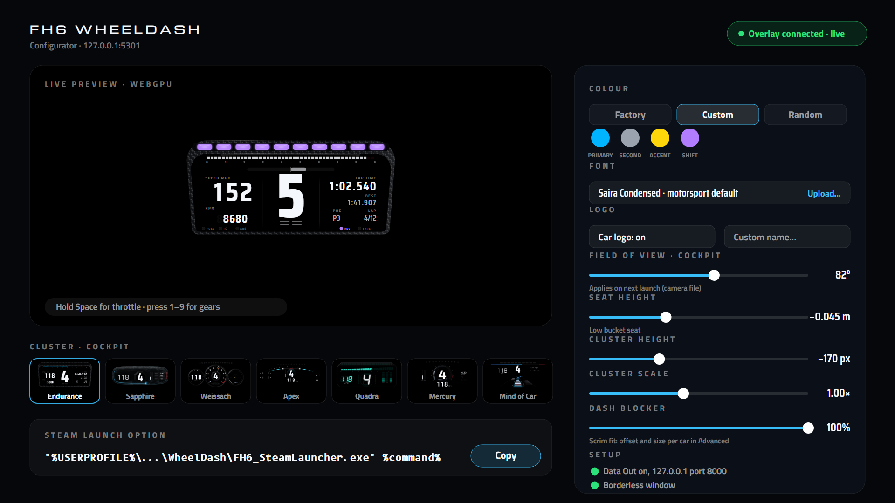

# Configurator direction (for Phase 10)

Board: [`boards/directions/configurator-direction.html`](boards/directions/configurator-direction.html) (1920×1080 desktop). Phase 10 builds the page (Rust → WASM, served by the exe at `127.0.0.1:5301`) from this frame.

## Intent
A set-and-forget web page: pick a cluster, colours, font and logo, set FOV, seat and cluster fit, copy the Steam launch option, and check the setup, while a **live WebGPU preview** (the same `fh6-kit` renderer) shows the result. Every change is written through `PUT /api/config` and hot-reloads in the running overlay.

## Layout (desktop 1920 wide; stacks to one column under 1200 px)
| Area | Content |
|---|---|
| Header | Michroma wordmark, "Configurator · 127.0.0.1:5301", connection pill ("Overlay connected · live", green; grey "Overlay not running" otherwise). |
| Live preview (left, 1120 × 560) | true-black canvas with the selected cluster; hint chip "Hold Space for throttle · press 1–9 for gears". |
| Cluster carousel | one card per cluster with a live thumbnail (cockpit; a second row for hood), the selected card ringed in accent. |
| Steam launch option | the exact command in B612 Mono, `"<install dir>\FH6_SteamLauncher.exe" %command%`, with a **Copy** button (copies; confirms "Copied"). |
| Settings column (right, 624 wide) | Colour (Factory / Custom / Random + swatches), Font (motorsport default + "Upload…"), Logo (car logo on/off, custom name), FOV (cockpit), seat height, cluster height, cluster scale, dash blocker (with "Scrim fit" per car under Advanced), Setup checklist. |

## Interaction
- Sliders snap to sensible steps (FOV 1°, seat 0.005 m, height 10 px, scale 0.05×) and show the value with its unit; arrow keys nudge.
- Camera values say "Applies on next launch (camera file)"; everything else applies live.
- Random shows "Re-roll" and "Lock"; Custom opens an OKLCH picker with the text-safe lift preview.
- Fonts: drop a TTF/OTF; the preview re-renders with cap-height-matched sizes; unsupported glyphs fall back to Noto Sans.

## Look
The configurator uses the same tokens as the clusters: `#05070A` page, `#0B1018` panels with 1 px hairlines (no heavy shadows), `text` (Titillium Web) for UI, `display` for values, `wide` for the wordmark, accent `#38BDF8` for focus and selection. Section labels are caps with +24% tracking at `inkLabel`.

## Setup checklist copy
- "Data Out on, 127.0.0.1 port 8000" (checks that packets arrive).
- "Borderless window" (checks the game window mode).
Each item turns green when verified live; otherwise it shows a one-line fix.

## Constraints
Rust-only: page logic in Rust (`web-sys`), the wasm-bindgen JS loader is a build artefact, never committed. Localhost only. No account, no analytics.
