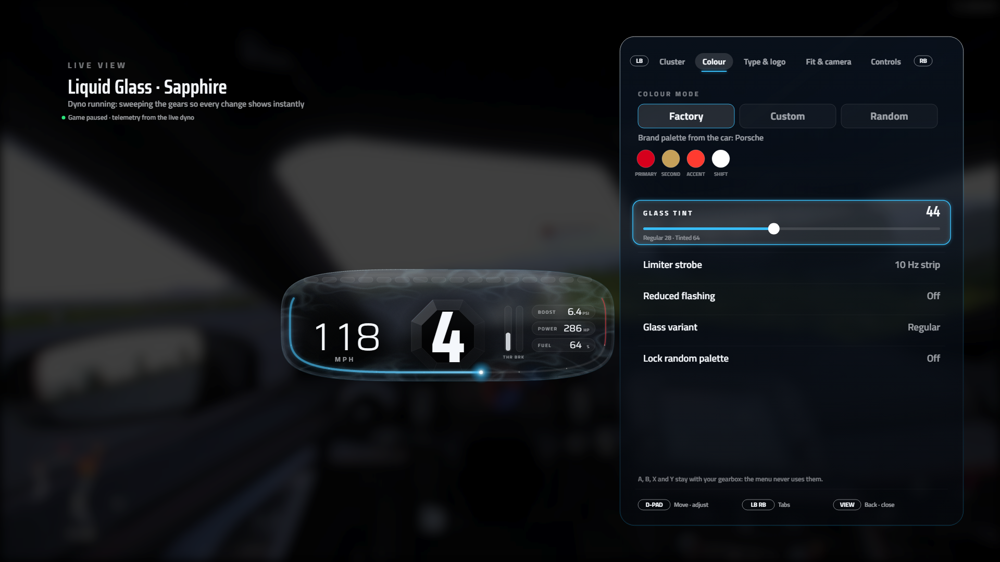

# OSD direction (for Phase 9)

Board: [`boards/directions/osd-direction.html`](boards/directions/osd-direction.html) (rendered at 1920×1080 from the 4K canvas). Phase 9 designs the full OSD from this frame.

## Intent
The OSD is the in-game control centre: full screen, **controller-first**, made of the Liquid Glass material, with the **live cluster** on the left so every change shows instantly. Opening it while racing pauses Forza (ESC via `SendInput`, only when `IsRaceOn == 1`), and the live dyno animates the selected cluster.

## Layout (4K)
| Area | Content |
|---|---|
| Backdrop | the paused game frame, blurred (σ ≈ 22 px at 4K) and dimmed to ≈ 45%. A black dimming layer, never a lifted grey. |
| Live view, left ≈ 60% | the real selected cluster at its real anchor and scale, driven by `LiveDynoGenerator` (gear sweep, springs, limiter strobe). Title in `display` 600 cap 54, status line "Game paused · telemetry from the live dyno". |
| Control column, right ≈ 40% (x 2380–3700, y 140–2020) | one glass panel (`glass.*`, tinted variant, radius 56): tab bar, the tab's controls, the controller hint bar. |
| Tabs (LB/RB) | Cluster · Colour · Type & logo · Fit & camera · Controls |
| Hint bar | D-pad "Move · adjust", LB RB "Tabs", View "Back · close", plus the line "A, B, X and Y stay with your gearbox: the menu never uses them." |

## Controls (as shown on the Colour tab)
- **Colour mode:** a 3-way segmented control: Factory (brand palette from the car, shown as 4 swatches: primary, secondary, accent, shift), Custom (D-pad hue / saturation / value editor plus presets), Random (press to re-roll, lock to keep).
- **Focused row:** glass row at alpha 18 with a 3 px accent focus ring and `glowSoft` (the only glowing element). Sliders use a 10 px track, accent fill and a 44 px white thumb; hold-to-repeat on the D-pad with acceleration.
- **Rows:** label left in `text` 600 cap 26, value right in `inkMuted`. Settings include limiter-strobe style, **reduced flashing** (accessibility), glass variant (regular / tinted), lock random palette.

## Type and focus at couch distance
- Labels `text` 600 at cap 26 minimum (≈ 8 mm on the 55" panel); section labels cap 18 caps with +24% tracking; values `display` for numbers.
- Focus must read from the couch: ring + glow + a 6% brighter row; never colour alone.
- Every input gets visual feedback on the next frame.

## Motion
- Open: the panel materialises over 200 ms (lensing and rim ramp), the live view's cluster glides in from its in-game position (LFA-style glide, ≈ 400 ms). Close: 1 frame.
- Tab change: the underline slides on the `fast` spring; content cross-fades over 150 ms.

## Microcopy rules (`design:ux-copy`)
- Sentence case, short verbs: "Copy", "Re-roll", "Lock". Units always shown ("82°", "−0.045 m", "1.00×").
- Camera changes say when they apply: "Applies on next launch (camera file)".
- Never instruct a button the menu does not use.

## Hard rules
Never A/B/X/Y (masks `0xF000` stripped). Toggle default: hold View `0x0020` for 400 ms, remappable in Controls. The OSD is the only state where the dash shows while paused. GPU budget for the whole OSD at 4K: under 1.5 ms.
