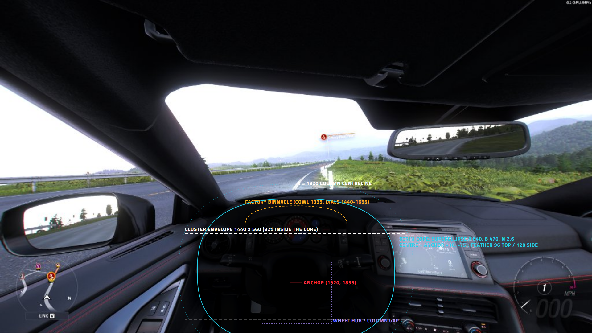

# SCRIM_FIT: the OEM dash blocker

The scrim is the domed, OLED-black shape that hides the game's own instrument binnacle in cockpit view `[3]`, so our cluster sits in a clean black field and two sets of dials never compete. Phase 8 implements and calibrates it; this file is its design spec.

| Board | What it shows |
|---|---|
| [`scrim/scrim-fit-annotated.png`](scrim/scrim-fit-annotated.png) | Measured geometry over `assets/reference/cockpit_with_wheel.jpg`, scrim at 55% so the factory binnacle stays visible under it |
| [`scrim/scrim-fit-stock-cockpit.png`](scrim/scrim-fit-stock-cockpit.png) | The final look: scrim at 100% and the Liquid Glass hero (mid cruise) at the default anchor |
| [`scrim/scrim-fit-low-seat.png`](scrim/scrim-fit-low-seat.png) | The same scrim and cluster over `target_wide_cockpit_fov.jpg` (low seat, wide FOV) with a −170 px user height offset |

Sources: `docs/design/boards/scrim/*.html` (pure SVG over the reference photo; render command in [BOARDS.md](BOARDS.md)). The reference photos are 1024×576, upscaled ×3.75 to 4K, so measurements are good to about ±8 px.

## 1. What the reference shows (4K coordinates)
Measured on `cockpit_with_wheel.jpg` with a 50 px grid:

| Feature | x | y |
|---|---|---|
| Binnacle cowl, top of the hood | apex 1920 | 1335 |
| Cowl outer sides | 1590 … 2250 | 1420 … 1450 at the shoulders |
| Factory dial cavity | 1690 … 2160 | 1440 … 1655 |
| Factory tach centre / radius | 1925 | 1540, r ≈ 95 |
| Wheel top rim and spokes (stalks at the sides) | 1590 … 2260 (stalks 1430–1600 and 2190–2370) | 1640 … 1760 |
| Wheel hub / column gap (already near-black) | 1700 … 2150 | 1700 … 2100 |
| Cluster anchor (cockpit) | 1920 | 1835 |
| Cluster envelope (scale 1.0) | 1200 … 2640 | 1515 … 2075 |

So the factory gauges sit **above** our cluster (around y 1335–1655) and our cluster sits over the wheel hub and column gap. The scrim must cover both: the factory binnacle above, and a black field behind the cluster.

## 2. The dome
A **superellipse** (squircle-dome), not a rectangle, centred on the steering-column line.

| Parameter | Value (4K px, scale 1.0) | Notes |
|---|---|---|
| Centre | anchor + (0, −75) → (1920, 1760) | follows the cluster anchor and scale; stays put when the user height offset moves the cluster (Phase 8: the factory binnacle does not move) |
| Semi-axes a × b | 640 × 470 | top at y 1290 (45 px above the cowl), sides at x 1280 … 2560 |
| Exponent n | 2.6 | between an ellipse (2) and a squircle (4): a domed hood, flat enough at the sides to cover the envelope |
| Core alpha | 255 × `OemDashOpaquePct` | pure `#000000` |
| Coverage | 82% of the cluster envelope lies inside the core | the brief asks for about 80% |
| Feather | 96 px at the top, 120 px at the sides, 140 px at the bottom corners | smoothstep falloff from the core alpha to 0, dithered with blue noise (Phase 6 tile) so the C1 shows no banding |
| Bottom | runs off the bottom of the screen (b reaches y 2230) | there is no bottom edge to see |

Shape test at the envelope: at y 1515 the core half-width is 592 px; at y 1760 it is 640; at y 2075 it is 541. The envelope corners (±720) fall in the feather, which is what keeps the scrim from reading as a box.

**Why a dome:** a real binnacle is a hood. The dome's top edge replaces the cowl lip with a clean arc that reads as part of the car, and its sides fall away before they reach the A-pillar vent (x ≈ 1300–1460) and the centre screen (x ≈ 2540+).

## 3. Layering
1. The game frame.
2. **Scrim** (core plus feather), alpha × `OemDashOpaquePct`.
3. **Binnacle ambient wash** (optional, existing `fh6-render` wash): a 1–2 px arc along the dome's top edge in the cluster's `primary` at alpha 12–35, brighter at night, like light spilling from the cluster onto the cowl lip. Never a fill.
4. The cluster (its glass at alpha 28–64 sits over the scrim's black, so glass reads as glass, not as a grey box).
5. The OSD, when open.

## 4. How the cluster sits in it
- The cluster's **optical centre** (the gear) lands at the dome's lower-centre third: anchor (1920, 1835) is 75 px below the dome centre. The rank-1 strip (shift lights) falls in the upper core, well clear of the feather.
- **Safe margins:** keep 40 px between any lit cluster element and the feather's inner edge, so bloom never spills over the feather onto the dash.
- **Wider clusters** (Race Dash, Liquid Glass capsule at 1280 px) use the dome's widest band (y 1700–1850); their ends may sit in the feather, which is intended: the dome fades under the bezel.
- **Hood view `[4]`:** the scrim is forced to 0% (`layout.hood.scrimPct`). The Modern Digital hood cluster carries its own legibility halo (a soft radial dark of alpha ≤ 0.55, never a box).
- **User controls:** scale (0.70–1.40) scales the dome with the cluster; the cluster height offset (±240 px) moves only the cluster, and the dome stays on the binnacle (Phase 8 decision after the fit critique). The configurator's "scrim fit" adds a per-car dome offset (dx, dy), scale (sx, sy) and `OemDashOpaquePct`, saved per car ordinal (Phase 8 decides the storage; the car profile is the natural home).

## 5. Low seat and wide FOV
In the low-seat target view (`target_wide_cockpit_fov.jpg`, `Param.y = −0.045`, `DefaultOffsetFromSteeringWheelY = −0.035`), the factory binnacle drops to about y 1330–1500 and is seen through the upper opening of the wheel. The default dome still covers it; the composite uses a −170 px height offset so the cluster sits in the upper wheel opening. Phase 8 should:
1. capture the real camera at the patched seat height and FOV for 3 reference cars (a sports car, a supercar, an SUV),
2. measure the factory binnacle box in each, and
3. store a per-car or per-class dome offset and scale, defaulting to the values above.

## 6. Acceptance checks (Phase 8)
- No factory needle or digit visible through the core at 100%, in day and night scenes.
- No visible scrim edge: the feather has no banding at 4K (dither on).
- The scrim never overlaps the side mirrors, the A-pillar vents or the centre screen at default scale.
- Hidden within 1 frame with the cluster (menus, pause, stale telemetry, Forza not focused).
- Hood view shows no scrim.
